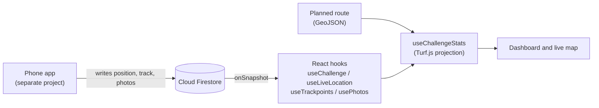

# Neusiedlersee Challenge - Live Tracking

A live GPS tracking dashboard for the Neusiedlersee Challenge, a 111 km hike around Lake Neusiedl (Austria) on May 2, 2026. The site shows the group's current position on the planned route, distance covered, pace, ETA, 10 km stage progress and a photo diary, all updated in real time from Cloud Firestore. It is a statically exported Next.js app hosted on Firebase Hosting: a phone app carried by the group writes to Firestore, and the browser subscribes with `onSnapshot`. The user interface is in German.

<!-- Screenshots: add docs/screenshots/*.png here -->

## Features

- **Live position and route progress:** GPS fixes are projected onto the planned GeoJSON route with Turf.js, so distance is measured along the route instead of summing noisy GPS hops. Fixes more than 600 m off-route are ignored.
- **Statistics:** distance covered and remaining, average speed, pace per km and estimated arrival time, throttled to avoid constant re-rendering.
- **Live map (`/live`):** full-screen Leaflet map with completed and remaining route segments and a share button (Web Share API with clipboard fallback).
- **Stage timeline:** progress in 10 km stages with time and pace per stage.
- **Photo diary:** photos from Firestore, each tagged with the km at which it was taken (binary search over the track's time/distance series).
- **Countdown** to the start with per-digit animation.
- **Time-of-day theme:** sky scene and colors change between morning, day, sunset and night. `?time=HH:MM` simulates other times for testing.
- **Weather widget** using the Open-Meteo API, cached for 15 minutes.
- **Final state:** after the finish (or an abort) all values are frozen so late GPS updates cannot change the result.
- **Dev/prod separation:** `NEXT_PUBLIC_ENV` switches between `_dev` and `_prod` Firestore collections.

## Architecture



The dashboard only reads from Firestore and never writes. There is no backend of its own: the static files are served by Firebase Hosting, and access control is handled by Firestore security rules.

More detail (Firestore layout, distance algorithm, layering, theming) is in [docs/ARCHITECTURE.md](docs/ARCHITECTURE.md).

## Tech stack

| Area | Technology |
|------|------------|
| Framework | Next.js 16 (Pages Router, static export), React 19, TypeScript |
| Data | Cloud Firestore (Firebase JS SDK 12) |
| Maps and geo | Leaflet, Turf.js, CARTO / OpenStreetMap tiles |
| Weather | Open-Meteo API |
| Hosting | Firebase Hosting |
| Tooling | ESLint (`eslint-config-next`) |

## Project structure

```
public/routes/        Planned route (GeoJSON) and BRouter waypoints
src/components/       Background map, sky scene, countdown, menu, footer, widgets
src/hooks/            Firestore subscriptions, derived statistics, clock and client hooks
src/lib/              Firebase init, geo math, theming, timestamp helpers, challenge config
src/pages/            Home, /live, /infos, legal pages, /view (device debug page)
src/styles/           Global CSS and design tokens
docs/                 Architecture notes
```

## Getting started

Requirements: Node.js 20 or newer, a Firebase project with Firestore enabled, and the Firebase CLI for deployment.

1. Install dependencies:

   ```bash
   npm install
   ```

2. Copy `.env.example` to `.env.local` and fill in the values from your Firebase web app config:

   | Variable | Description |
   |----------|-------------|
   | `NEXT_PUBLIC_FIREBASE_API_KEY` | Firebase web API key |
   | `NEXT_PUBLIC_FIREBASE_AUTH_DOMAIN` | e.g. `<project>.firebaseapp.com` |
   | `NEXT_PUBLIC_FIREBASE_PROJECT_ID` | Firebase project ID |
   | `NEXT_PUBLIC_FIREBASE_STORAGE_BUCKET` | Storage bucket |
   | `NEXT_PUBLIC_FIREBASE_MESSAGING_SENDER_ID` | Sender ID |
   | `NEXT_PUBLIC_FIREBASE_APP_ID` | Web app ID |
   | `NEXT_PUBLIC_ENV` | `dev` or `prod`, selects the Firestore collections |
   | `NEXT_PUBLIC_TRACKER_DEVICE_ID` | Document ID in `dev_locations_*` shown on `/view/[sessionId]` |

   These are public client-side values that end up in the built JavaScript. Access control belongs in Firestore security rules (read-only for the public dashboard).

3. Start the development server on http://localhost:3000:

   ```bash
   npm run dev
   ```

4. Build the static site into `out/`. `build:clean` removes `.next/` and `out/` first, which avoids stale-cache build errors:

   ```bash
   npm run build:clean
   ```

5. Deploy to Firebase Hosting:

   ```bash
   firebase use <your-project-id>
   firebase deploy --only hosting
   ```

Other scripts: `npm run lint` runs ESLint.

## What I learned

- **Measuring distance on a known route.** Summing GPS hops overstates distance because of jitter. Projecting each fix onto the planned route and slicing the line gives a stable value, but needs rules for off-route fixes and a start-point offset.
- **Handling messy timestamps.** The same field arrived as milliseconds, seconds, strings or Firestore `Timestamp` objects, so all of it goes through one normalization helper.
- **Separating test and live data** in one Firestore project through environment-dependent collection names.
- **Scroll and layering bugs.** A fixed Leaflet background captured wheel events in Chrome; the fix was to let only the body scroll and make background layers `pointer-events: none`.
- **React state pitfalls.** The first countdown animation stopped after a few seconds because of a stale closure; comparing against a ref fixed it. Later, the stricter React Hooks lint rules (React Compiler) flagged refs mutated during render in the statistics hook; it now keeps its incremental state in an immutable cache and calculates with a pure function.

## License

[MIT](LICENSE) - Copyright (c) 2026 Florian Zainzinger
